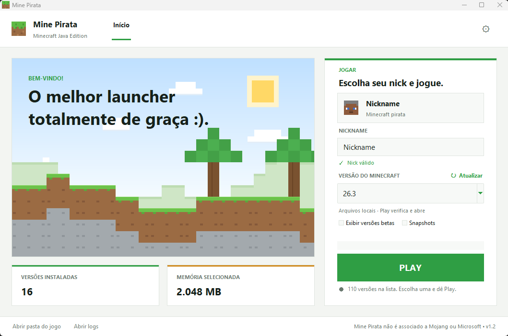

# Mine Pirata

Launcher leve de Minecraft Java, feito em Python com Tkinter.



## Como usar

1. Execute **MinePirata-Setup-1.0.exe** para instalar. Não precisa instalar Python.
2. Escolha seu nick e a versão do Minecraft.
3. Clique em **Play**. O launcher baixa o que faltar e abre o jogo.
4. Com o jogo aberto, use **Fechar** para encerrar o processo.

As versões instaladas aparecem no topo da lista. Use os filtros para exibir versões históricas e snapshots.

Os arquivos do jogo ficam em `%APPDATA%\.minecraft`. As configurações ficam em `%APPDATA%\BlockLauncher`.

## Executar pelo código

Requer Python 3.10 ou superior com Tcl/Tk. Sem dependências pip.

```powershell
python launcher.py
```
